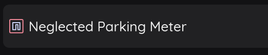
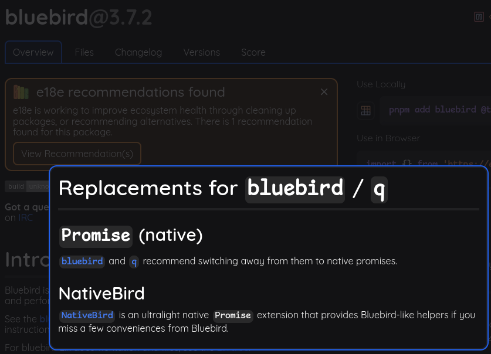
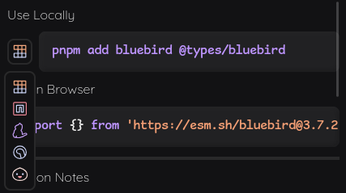
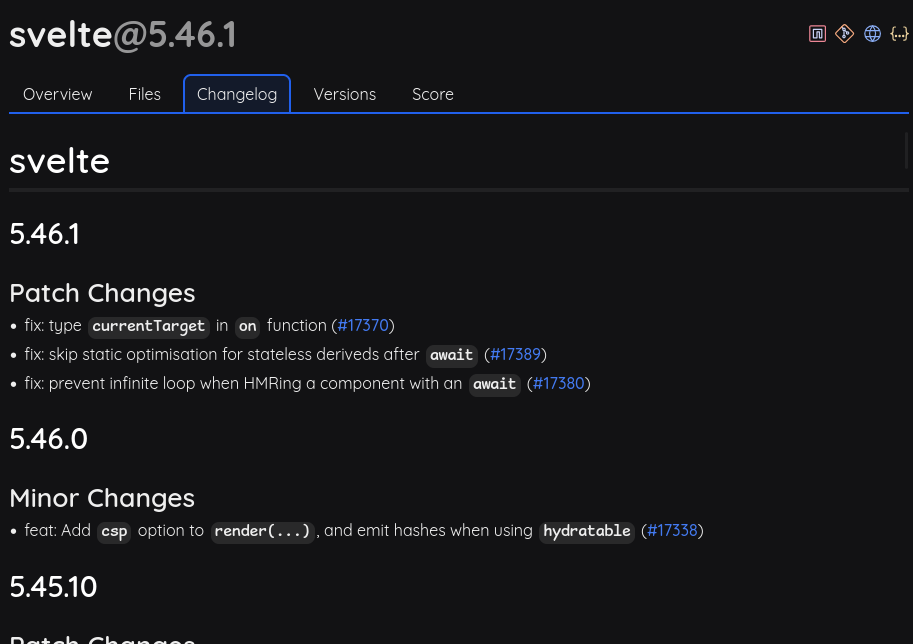
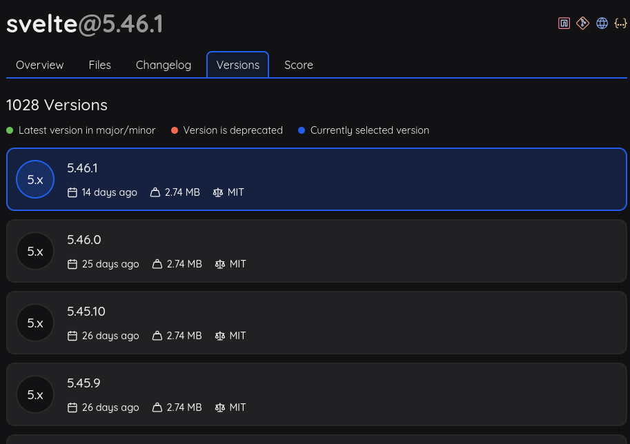
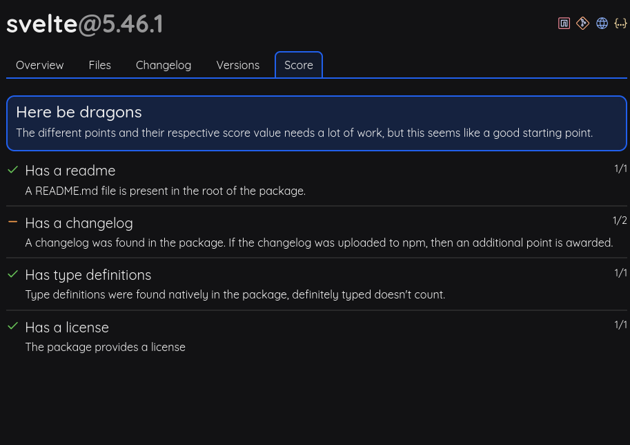
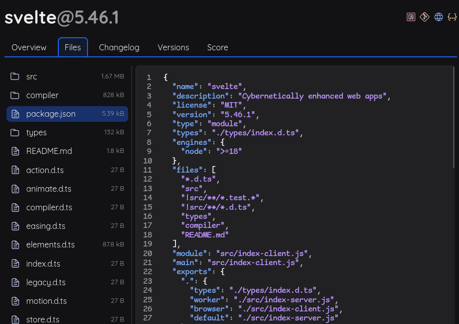
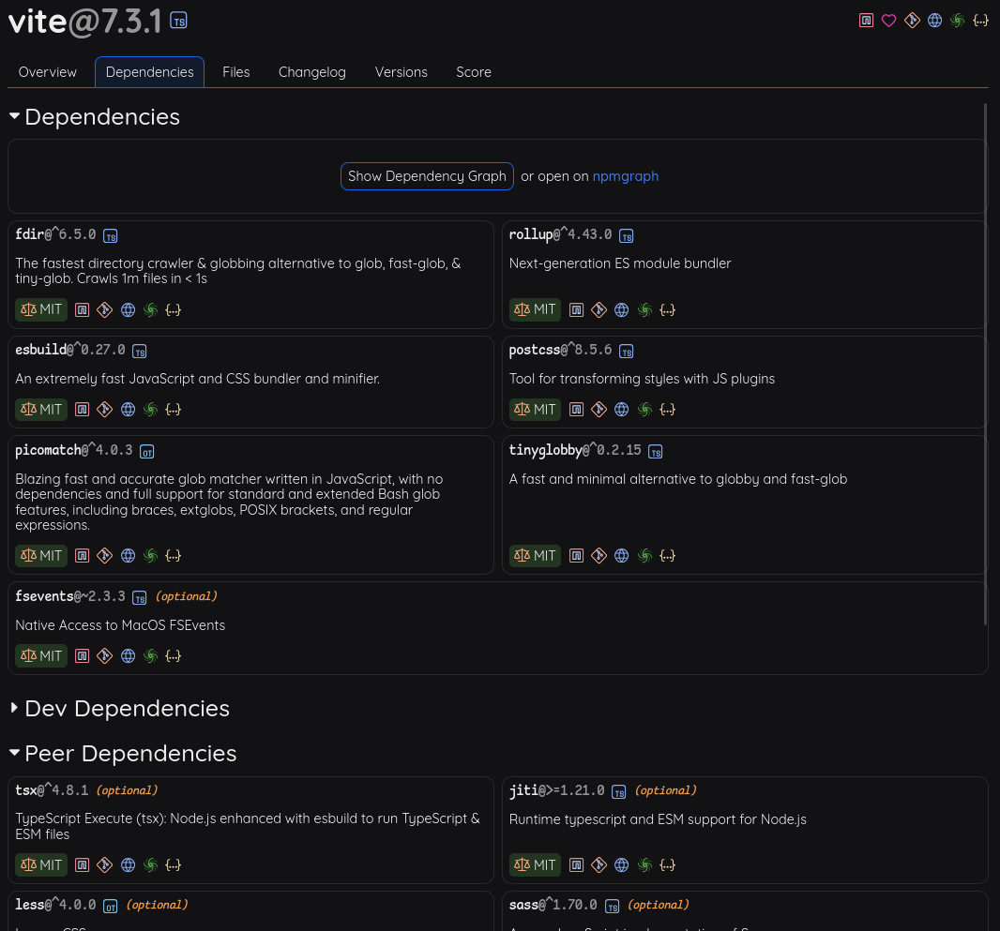
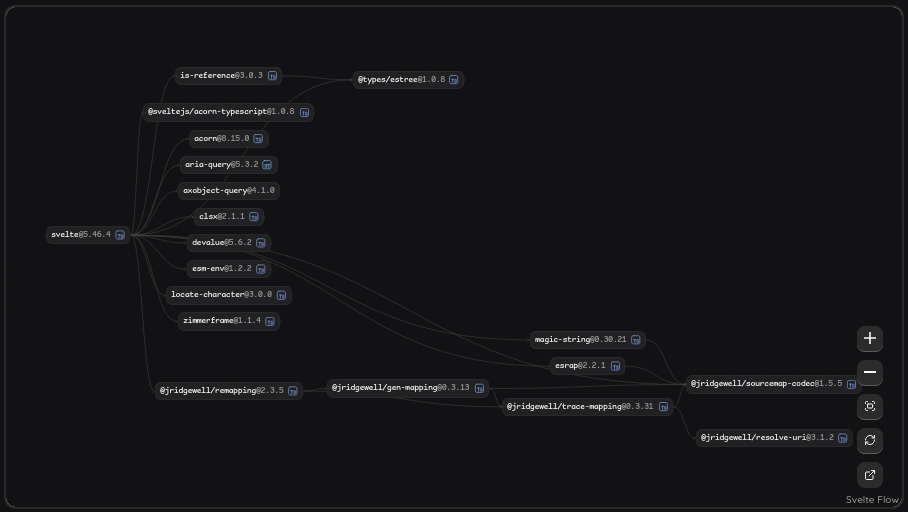

# npm-alt

> [!NOTE]
> Go checkout [npmx.dev](https://npmx.dev) for the spiritual successor to npm-alt, with tons more features and a vibrant community.
>
> If you're interested in the data aspect, you can also join the #data channel on the [e18e discord](https://chat.e18e.dev) where some of us are working on npm.rest, which includes a lot of the data work from here.

An alternative frontend for npm that aims to provide a better experience, with more useful supplemental information.

## Extra Features

### npm acronyms

The most important feature, the old npm acronyms.

### e18e suggestions

Shows e18e suggestions on packages.

### install options

- Selectable package manager install options
- Adds the @types package if required
- Shows browser import for script[type=module]

### changelog viewer

Tries to fetch the changelog from the npm package files, the repo, or GitHub releases.

### better version viewer

Inspired by jsr/crates.io

### package score

Inspired by jsr, very much a work in progress

### non-beta file viewer

:p

### better dependency list

accounts for regular/production, optional, peer, and dev dependencies.

also with built-in production dependency graph

